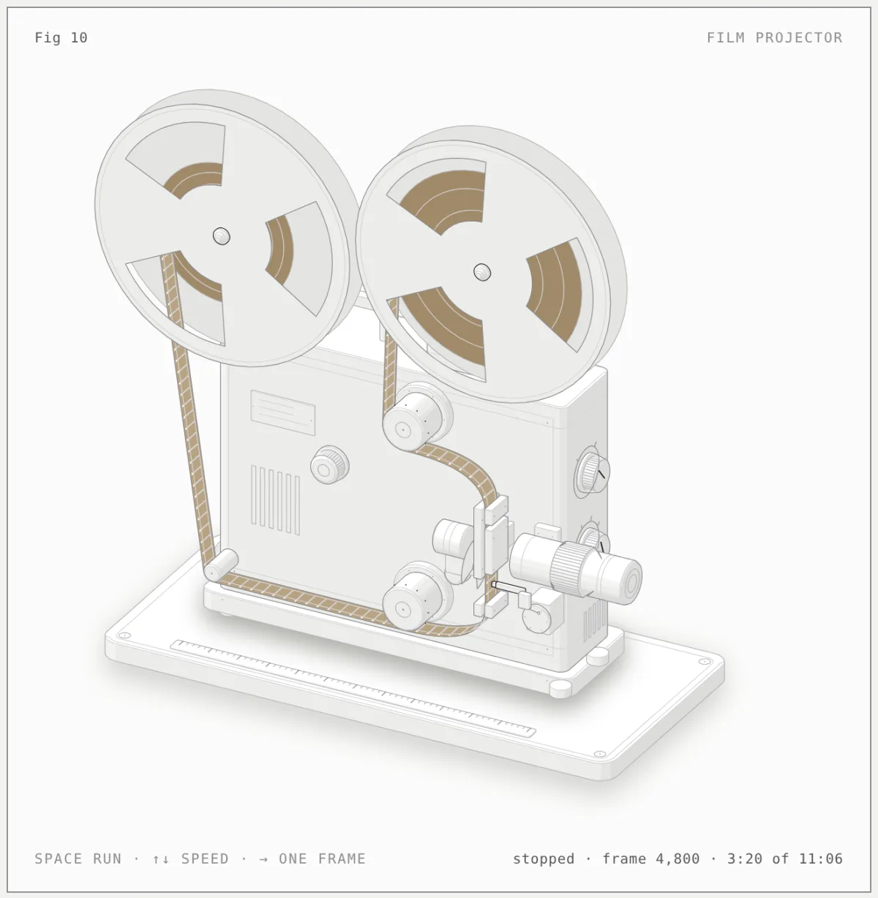
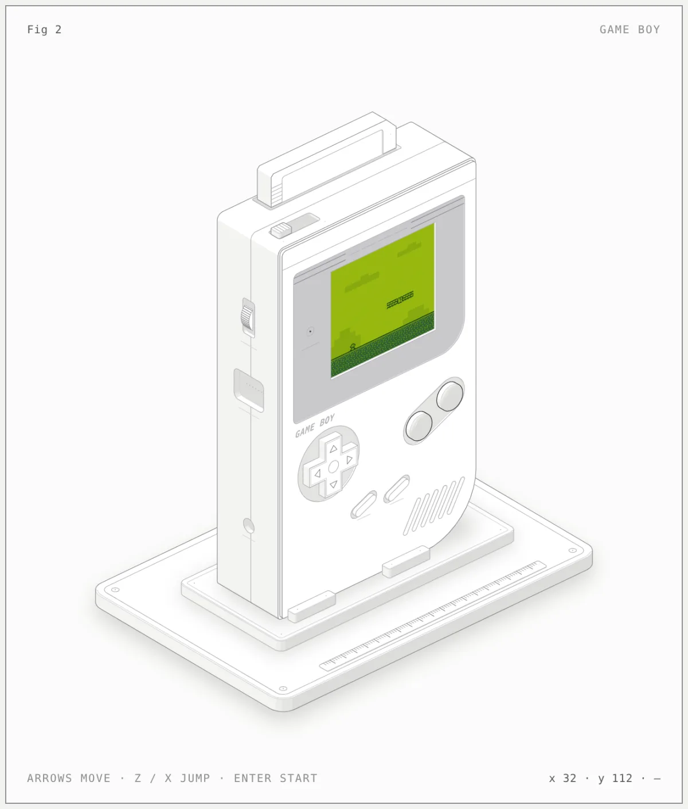
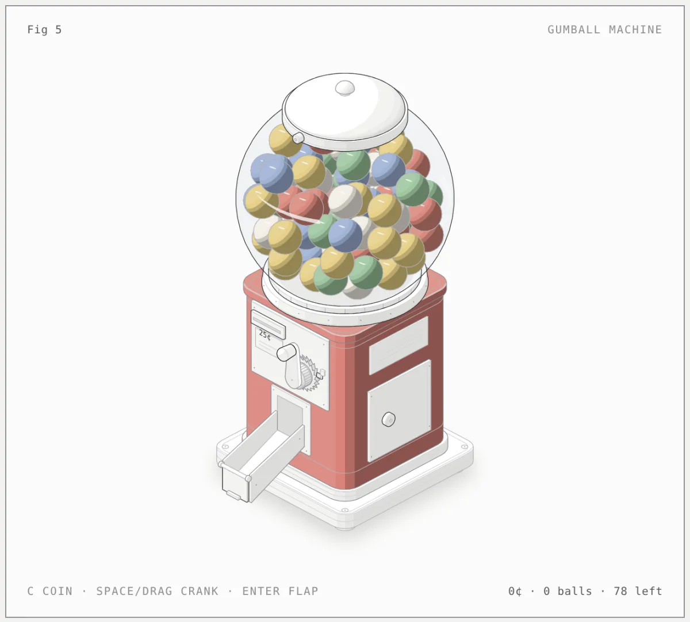
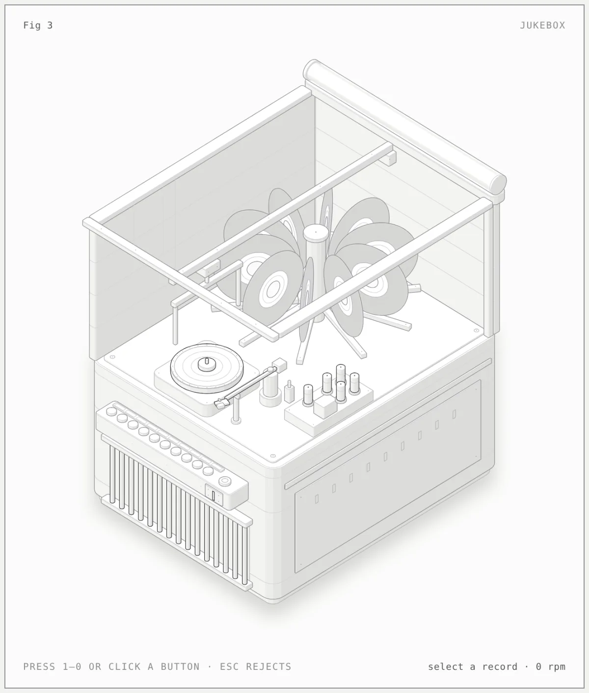
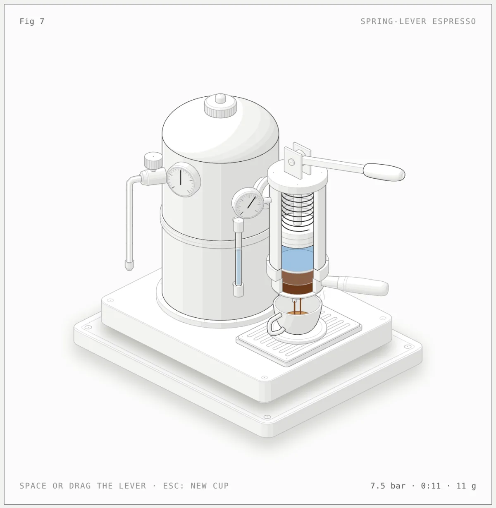
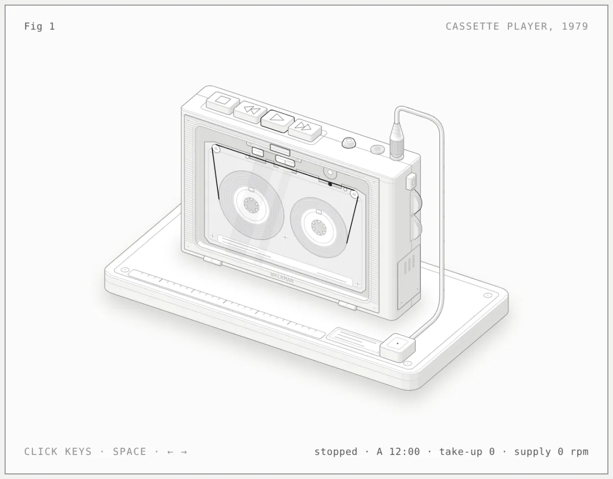
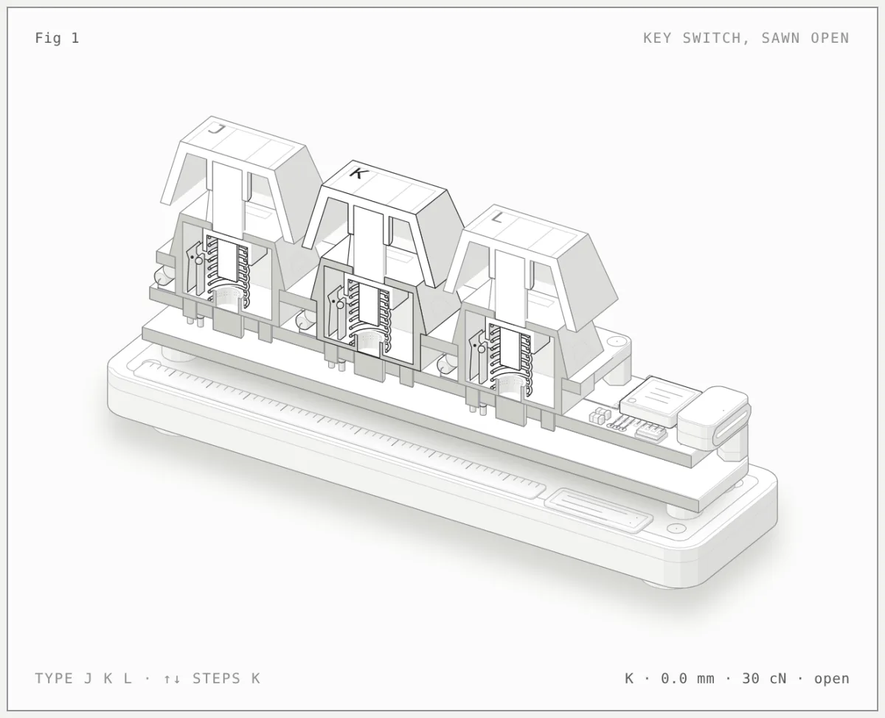
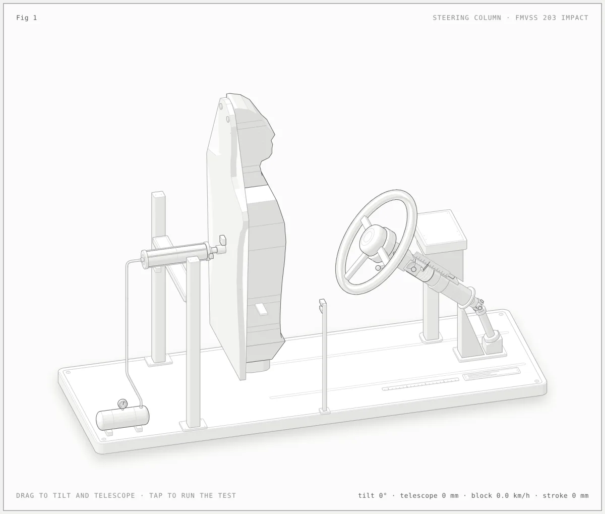

# Anatomy community: figures

Written by CI after every merge to `main`: each preview is the light page of the figure, built from its source in the locked sandbox. Don't edit this branch by hand.

20 figures from 9 authors.

[Newest](README.md) · [All figures](all/1.md) · By kind: [SVG](by-kind/svg.md) · [SVG + WebGL](by-kind/webgl.md) · [SVG + 3D](by-kind/3d.md)

## Newest

| Preview | Figure |
|---|---|
|  | **Cu/diamond composite: post-mixing vs pre-coating** by [@entity](by-author/entity.md) SVG · Claude Code · 2026-10-12 |
|  | **Film projector** by [@entity](by-author/entity.md) SVG · Claude Code · 2026-10-12 |
|  | **Game Boy** by [@entity](by-author/entity.md) SVG · Claude Code · 2026-10-12 |
|  | **Gumball machine** by [@entity](by-author/entity.md) SVG · Claude Code · 2026-10-12 |
|  | **Jukebox** by [@entity](by-author/entity.md) SVG · Claude Code · 2026-10-12 |
|  | **Lever espresso machine** by [@entity](by-author/entity.md) SVG · Claude Code · 2026-10-12 |
|  | **NES controller** by [@entity](by-author/entity.md) SVG · Claude Code · 2026-10-12 |
|  | **Polaroid camera** by [@entity](by-author/entity.md) SVG · Claude Code · 2026-10-12 |
|  | **Pop-up toaster** by [@entity](by-author/entity.md) SVG · Claude Code · 2026-10-12 |
|  | **Walkman cassette player** by [@entity](by-author/entity.md) SVG · Claude Code · 2026-10-12 |
|  | **Floating-caliper disc brake** by [@gudguliai](by-author/gudguliai.md) SVG &#43; 3D · Other · 2026-10-12 |
|  | **How Machu Picchu was built** by [@jcroccomendez](by-author/jcroccomendez.md) SVG · Claude Code · 2026-10-12 |
|  | **Powerbank anatomy: how a 25,000 mAh 200 W powerbank works** by [@minhaajre](by-author/minhaajre.md) SVG · OpenCode · 2026-10-12 |
|  | **Automatic watch** by [@srirangam-r](by-author/srirangam-r.md) SVG · Claude Code · 2026-10-12 |
|  | **Keyboard switch, sawn open** by [@taqh](by-author/taqh.md) SVG · Claude Code · 2026-10-12 |
|  | **BMW iX3 on the bench** by [@tiago-varandas](by-author/tiago-varandas.md) SVG · Claude Code · 2026-10-12 |
|  | **Steering Column Impact Test** by [@vinayanand3](by-author/vinayanand3.md) SVG · Claude Code · 2026-10-12 |
|  | **Dial indicator** by [@wheresryan22](by-author/wheresryan22.md) SVG · Claude Code · 2026-10-12 |
|  | **Raptor engine on the test stand** by [@wheresryan22](by-author/wheresryan22.md) SVG &#43; WebGL · Claude Code · 2026-10-12 |
|  | **Ripple tank** by [@wheresryan22](by-author/wheresryan22.md) SVG &#43; WebGL · Claude Code · 2026-10-12 |
