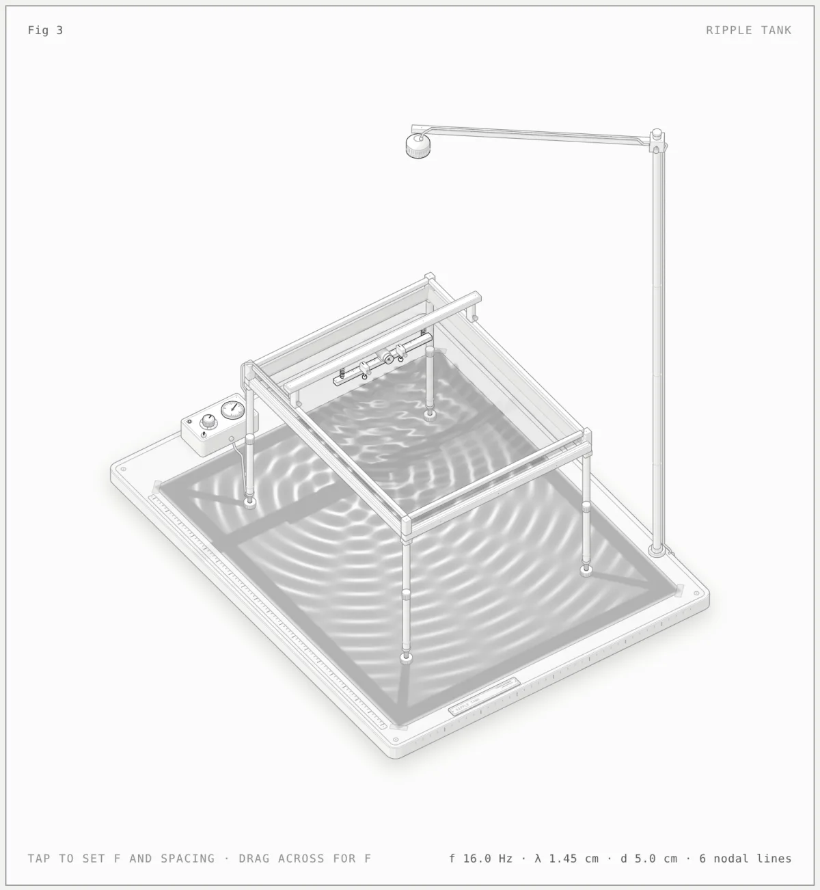

# SVG + WebGL figures

[Newest](../README.md) · [All figures](../all/1.md) · By kind: [SVG](../by-kind/svg.md) · [SVG + WebGL](../by-kind/webgl.md) · [SVG + 3D](../by-kind/3d.md)

2 figures.

| Preview | Figure |
|---|---|
|  | **Raptor engine on the test stand** by [@wheresryan22](../by-author/wheresryan22.md) SVG &#43; WebGL · Claude Code · 2026-10-12 |
|  | **Ripple tank** by [@wheresryan22](../by-author/wheresryan22.md) SVG &#43; WebGL · Claude Code · 2026-10-12 |
